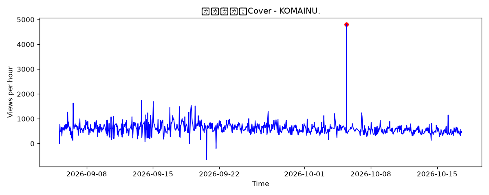
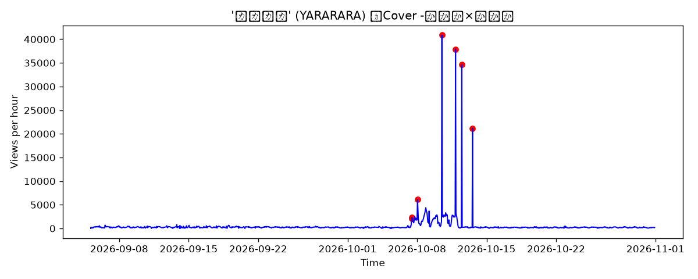
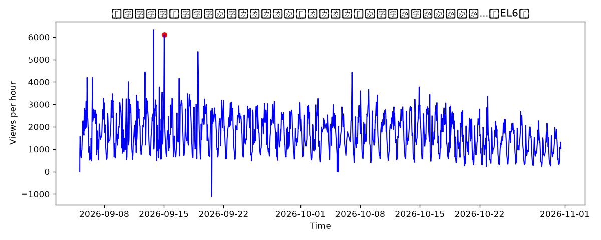

# 📊 自動分析レポート
生成時刻: **2026-10-18 08:00:20.486344**

## 🏆 成長速度ランキング

| videoId     |     total_growth |   avg_hourly |   max_spike |
|:------------|-----------------:|-------------:|------------:|
| T24rF_x0TmQ |      1.19186e+07 |    11832.1   |     3.81418 |
| xJQ6KrmdpD0 |      1.91626e+06 |     1843.37  |     3.06987 |
| SnZvS3f5IrA | 629247           |      607.728 |     6.03555 |
| pRy8kStWlAw | 575345           |      557.998 |    19.151   |

# 4版 波及モデル

## 波及元: 'ヤラララ' (YARARARA) ／Cover -しゆん×ばぁう (pRy8kStWlAw)

- 強度: 19.15x

- 発生時刻: 2026-10-13 13:59:00

### 'ヤラララ' (YARARARA) ／Cover -しゆん×ばぁう → 【以心伝心】新人歌い手グループが『ヤラララ』を本気で歌ってみたら...【EL6】
- lag: -685.0h
- strength: 16.0%

### 'ヤラララ' (YARARARA) ／Cover -しゆん×ばぁう → [MV] ABM - 'ヤラララ' (YARARARA) feat. 重音テト
- lag: -344.0h
- strength: 17.3%

### 'ヤラララ' (YARARARA) ／Cover -しゆん×ばぁう → [MV] ABM - 'ヤラララ' (YARARARA) feat. 重音テト
- lag: -343.1h
- strength: 19.9%

### 'ヤラララ' (YARARARA) ／Cover -しゆん×ばぁう → [MV] ABM - 'ヤラララ' (YARARARA) feat. 重音テト
- lag: -342.1h
- strength: 15.9%

### 'ヤラララ' (YARARARA) ／Cover -しゆん×ばぁう → [MV] ABM - 'ヤラララ' (YARARARA) feat. 重音テト
- lag: -341.1h
- strength: 16.5%

### 'ヤラララ' (YARARARA) ／Cover -しゆん×ばぁう → [MV] ABM - 'ヤラララ' (YARARARA) feat. 重音テト
- lag: -340.0h
- strength: 17.1%

### 'ヤラララ' (YARARARA) ／Cover -しゆん×ばぁう → [MV] ABM - 'ヤラララ' (YARARARA) feat. 重音テト
- lag: -338.0h
- strength: 17.2%

### 'ヤラララ' (YARARARA) ／Cover -しゆん×ばぁう → ヤラララ／Cover - KOMAINU.
- lag: -195.7h
- strength: 31.5%

## 📈 時速グラフ（各版）

### ヤラララ／Cover - KOMAINU.

### [MV] ABM - 'ヤラララ' (YARARARA) feat. 重音テト
![[MV] ABM - 'ヤラララ' (YARARARA) feat. 重音テト](graph_T24rF_x0TmQ.png)

### 'ヤラララ' (YARARARA) ／Cover -しゆん×ばぁう

### 【以心伝心】新人歌い手グループが『ヤラララ』を本気で歌ってみたら...【EL6】

